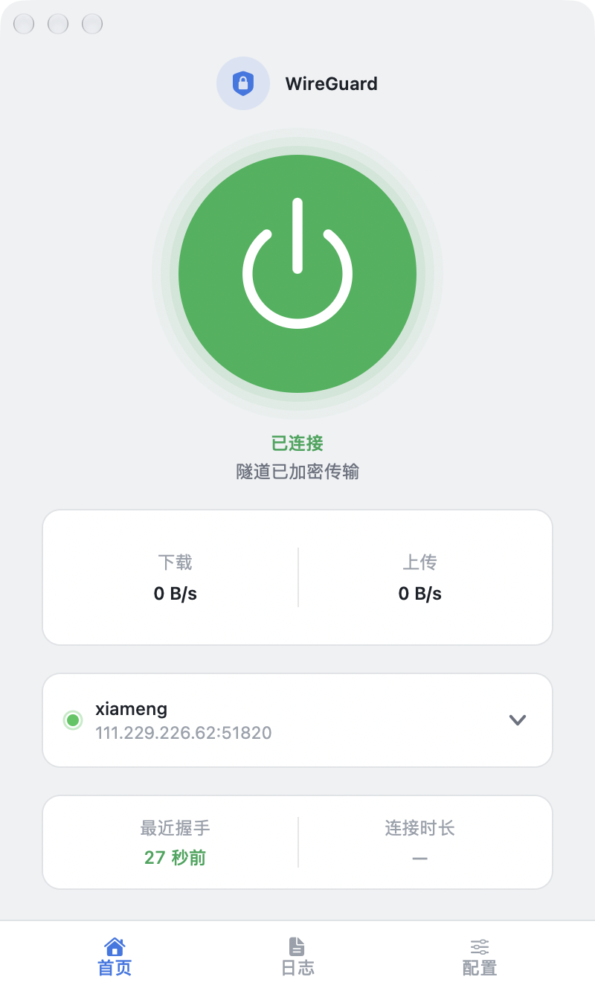

# WireGuard 控制台 · macOS

一个轻量的 macOS WireGuard 图形客户端：导入 `.conf`、一键连接/断开、实时显示握手与流量。
**纯原生 AppKit 实现**，无 WebView、无后台服务、无第三方依赖。



## 特性

- **卡片式单页界面** — 大圆按钮连接、实时上下行速率、连接时长
- **握手判定** — 只有真实握手成功才显示「已连接」，超时自动断开并给出诊断，不会出现"假连接"
- **配置管理** — 拖拽或粘贴导入 `.conf`、编辑、重命名、删除
- **节点切换** — 下拉快速切换多份配置
- **日志面板** — 完整记录 `wg-quick` 输出与握手结果，按级别着色
- **菜单栏常驻** — 不必打开主窗口即可查看状态、快速连接
- **浅色 / 深色友好** 的 UI，跟随系统

## 界面

| 首页 | 日志 | 配置 |
|---|---|---|
| 连接状态 / 速率 / 节点 | 分级着色日志 | 每行可连接 / 编辑 / 删除 |

## 环境要求

- macOS 13+（在 macOS 26/27 上开发测试）
- [wireguard-tools](https://formulae.brew.sh/formula/wireguard-tools)（提供 `wg` / `wg-quick`）
  ```sh
  brew install wireguard-tools
  ```
- 编译只需要 **Xcode Command Line Tools**（无需完整 Xcode、无需开发者账号）

## 安装

### 1. 授权 sudo（一次性）

App 需要免密调用 `wg` / `wg-quick`。在终端执行（`$USER` 会自动展开为你的用户名）：

```sh
sudo sh -c 'echo "$USER ALL=(root) NOPASSWD: /opt/homebrew/bin/wg-quick, /opt/homebrew/bin/wg" > /etc/sudoers.d/wireguard-gui && chmod 440 /etc/sudoers.d/wireguard-gui'
```

> 授权范围仅限这两个命令，不是全局免密。撤销：`sudo rm /etc/sudoers.d/wireguard-gui`

### 2. 构建并安装

```sh
git clone <本仓库地址>
cd WireGuard
./build.sh                # 编译 + 组装 .app + 安装到 /Applications
./build.sh --no-install   # 只构建到 app/build/，不安装
```

### 3. 使用

打开「WireGuard 控制台」→ 配置页「导入」→ 拖入或粘贴 `.conf` → 回到首页点圆形按钮连接。

## 配置说明

配置文件存放于 `~/Library/Application Support/WireGuardConsole/profiles/`（权限 600）。

**配置名即接口名**，受 `wg-quick` 限制：

- 只能用 **英文字母、数字和 `_ = + . -`**
- **最长 15 个字符**
- **不支持中文**（`wg-quick` 会把文件名当作网络接口名，必须为 ASCII）

**关于 `AllowedIPs`**

- `0.0.0.0/0` = 全流量走隧道。若对端不可达，会导致整机断网（App 会先弹警告）
- 只需访问内网时建议分段，例如 `192.168.3.0/24`

**关于 `DNS` 行**

macOS 的 `wg-quick` 处理 `DNS =` 依赖 `resolvconf`，部分配置会报错。
若不需要隧道内 DNS，删掉该行即可（路由仍生效）。反复 up/down 后若出现 DNS 残留，
可执行：

```sh
sudo sh -c 'networksetup -setdnsservers "Wi-Fi" Empty; dscacheutil -flushcache; killall -HUP mDNSResponder'
```

## 依赖

- [wireguard-tools](https://formulae.brew.sh/formula/wireguard-tools)（`wg` / `wg-quick`）
- macOS 13+ + Command Line Tools

## 目录结构

```
app/
  main.swift         应用入口、主窗口、菜单栏、导入/密钥/删除弹窗
  WGCore.swift       逻辑层：wg / wg-quick 调用、配置管理、状态解析、握手判定
  HomeView.swift     首页：大圆按钮、速率卡、节点卡、握手卡
  TabsView.swift     日志页、配置页、底部标签栏
  PowerButton.swift  自绘控件：大圆按钮、下拉箭头、下拉浮层、卡片
  make_icon.swift    图标生成脚本（CoreGraphics）
  Info.plist         App 元信息
build.sh             编译 + 组装 .app + 安装
static/、server.py   早期网页版（保留备查，非主程序）
```

## 实现要点

- **不用 SwiftUI**：CLT 的 SDK 缺少 `SwiftUIMacros` 插件，`@State` 等宏无法展开，
  因此全部用 AppKit 手写。这样只需 Command Line Tools 即可编译。
- **把握手当作唯一连接判据**：`wg show <iface> latest-handshakes` 返回 0 时视为未连接。
  状态机：`disconnected → connecting → awaitingHandshake → connected / failed`。
- **接口名发现**：macOS 上接口是 `utunX`，与配置名不同。通过读取
  `/var/run/wireguard/<配置名>.name` 判断哪个配置在运行（`wg-quick` up 创建、down 删除）。
- **弹窗不越界**：所有下拉/浮层用窗口内的 `NSView` 覆盖层实现，而非独立 `NSPanel`，
  并按宿主 bounds 做位置钳制。

## 已知限制

- 不支持中文配置名（见上文 `wg-quick` 限制）
- 同一时间只建议运行一个隧道（多隧道场景下路由与 DNS 可能互相覆盖）
- 需要 `wg` / `wg-quick` 位于 `/opt/homebrew/bin/`（Apple Silicon Homebrew 默认路径）；
  Intel Mac 请修改 `WGCore.swift` 中的 `wgPath` / `wgQuickPath`

## 许可证

[MIT](LICENSE)
